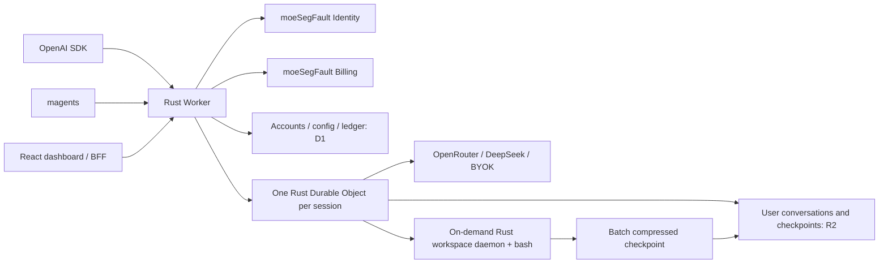

# moeSegFault Agents

Rust agent sessions on Cloudflare Workers, Durable Objects and on-demand container workspaces. OpenAI-compatible clients call an agent configuration as a model; `magents` and the React dashboard manage the same account and sessions.

| Surface | Production | Staging |
| --- | --- | --- |
| API | `https://agents.moesegfault.dev/v1` | `https://agents-staging.moesegfault.dev/v1` |
| Dashboard | `https://adash.moesegfault.dev` | `https://adash-staging.moesegfault.dev` |

These are deployment targets, not a claim that an environment has passed acceptance. Staging is delivered and verified before production. See [acceptance](docs/acceptance.md) for recorded evidence and limitations.



## Call an agent

Create an account API key and an agent configuration first. The SDK `model` is the **agent ID**, not the upstream provider model. Management uses cookie-bound BFF authentication or a registered native client's bearer credential; do not put an OAuth bearer token in browser storage.

```python
import os
from openai import OpenAI

client = OpenAI(
    base_url="https://agents-staging.moesegfault.dev/v1",
    api_key=os.environ["MAGENTS_API_KEY"],
)
response = client.chat.completions.with_raw_response.create(
    model=os.environ["MAGENTS_AGENT_ID"],
    messages=[{"role": "user", "content": "What time is it?"}],
)
session_id = response.headers["x-agents-session"]
print(response.parse().choices[0].message.content)

# Append new input only: the session already owns its conversation history.
answer = client.chat.completions.create(
    model=os.environ["MAGENTS_AGENT_ID"],
    messages=[{"role": "user", "content": "Continue with the next step."}],
    extra_headers={"x-agents-session": session_id},
)
```

This implements the documented chat-completions subset, not every OpenAI API. See [HTTP contracts](docs/api.md) and [CLI](docs/cli.md).

## Invariants

- Instructions, resolved tool schemas and skills are pinned when a session is created. Configuration changes affect new sessions, not existing cache prefixes.
- Context compaction is a validated percentage of the selected model's context budget. Compaction does not overwrite the original conversation journal.
- Reads, model output and tool activity do not change the last-user-append clock. A running task continues after ten minutes without new input; it archives and releases its workspace after completion. Idle sessions archive at ten minutes.
- Harness tools and workspace tools have separate execution boundaries. Bash never receives provider keys, OAuth tokens, R2 credentials or the supervisor's authentication secret.
- Checkpoint upload and durable pointer commit precede container destruction. A failed checkpoint fails visibly rather than pretending data was saved.
- Free accounts have explicit limits. Model usage and infrastructure usage use an idempotent monetary ledger and versioned tariffs, not sampling-based telemetry.
- User data, intermediate execution state, monetary records and opt-in diagnostics have different storage and retention policies.

## Repository

| Path | Responsibility |
| --- | --- |
| `crates/agents-core` | Platform-independent state, pinned context, configuration and quotas |
| `crates/agents-auth` | Identity validation, encryption and exact monetary domain types |
| `crates/agents-worker` | Worker API, Rust session/auth Durable Objects, providers and bindings |
| `crates/workspace-daemon` | Credential-isolated bash supervisor, checkpoint and restore |
| `crates/magents` | Rust management CLI and system-browser login |
| `apps/dashboard` | Same-origin React management UI |
| `migrations` | Agents D1 schema and accounting constraints |
| `tests/e2e` | Actual SDK and container HTTP user journeys |

Read [architecture](docs/architecture.md), [workspace](docs/workspace.md), [observability](docs/observability.md), and [deployment](docs/deployment.md). Tests and optimized builds run on GitHub Actions; local work is limited to focused checks and user journeys when useful.

## Development

```sh
npm ci
npm --prefix apps/dashboard ci
npm --prefix apps/dashboard run build
cargo test --locked -p agents-core -p agents-auth -p magents
cargo install --locked worker-build --version 0.8.7
npm run build:worker
```

`wrangler dev --env staging` also requires Docker for container work and a deliberately configured local Identity client. Never reuse production login callbacks or secrets for local development. The daemon must run in its dedicated container; do not run its privileged supervisor directly on a shared host.

License: GPL-3.0-only; see [LICENSE](LICENSE).
